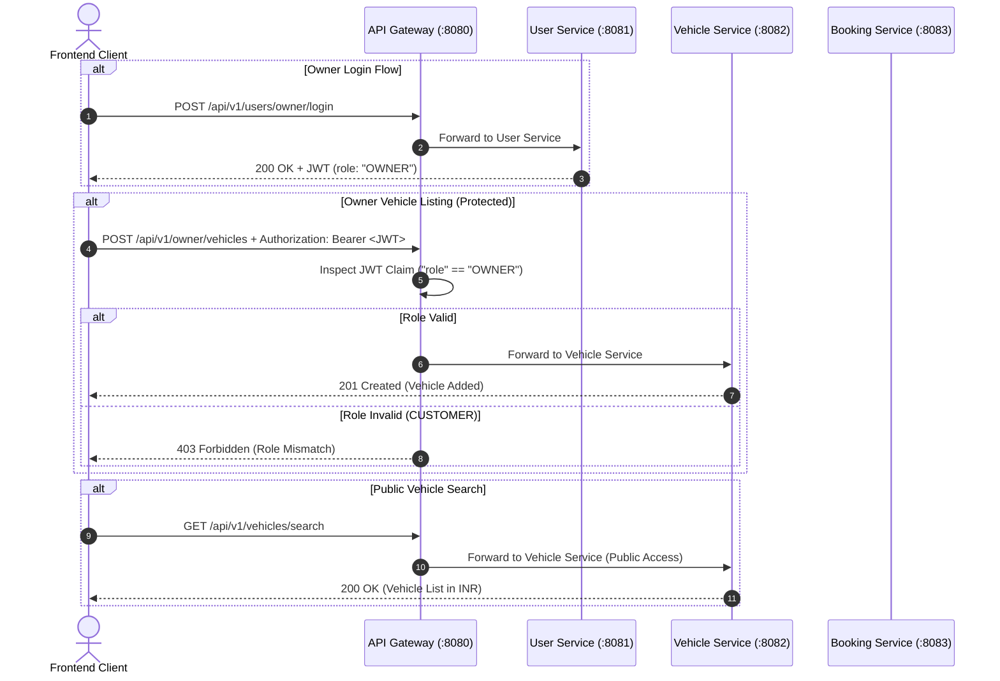
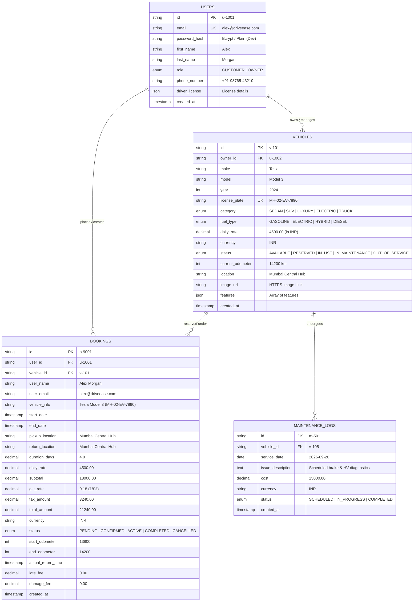

# DriveEase Fleet Operations — Technical Specifications & Database Schemas

## 1. Executive Summary & Architecture Overview

DriveEase is a microservices-based vehicle rental and fleet management platform engineered with Spring Cloud architecture patterns (Spring Cloud Gateway, Eureka Service Discovery, JWT Authentication, and State Machine workflows). 

The platform supports two distinct user roles: **Customer** (renter) and **Owner** (fleet manager/admin). Both roles share a single User Service and unified `users` table, but utilize role-segregated entry points, JWT scope enforcement at the API Gateway, and role-restricted frontend dashboards. All financial metrics and vehicle rates operate strictly in **Indian Rupees (₹ / INR)**.

```
                               ┌─────────────────────────┐
                               │     React 18 SPA        │
                               │ (Customer & Owner Portals)│
                               └────────────┬────────────┘
                                            │ HTTP / JSON (Port 3000)
                                            ▼
                               ┌─────────────────────────┐
                               │    Spring API Gateway   │ (Port 8080)
                               │ (JWT Role Enforcement)  │
                               └────────────┬────────────┘
                        ┌───────────────────┼───────────────────┐
                        │                   │                   │
                        ▼                   ▼                   ▼
            ┌───────────────────┐ ┌───────────────────┐ ┌───────────────────┐
            │   User Service    │ │  Vehicle Service  │ │  Booking Service  │
            │    (Port 8081)    │ │    (Port 8082)    │ │    (Port 8083)    │
            └─────────┬─────────┘ └─────────┬─────────┘ └─────────┬─────────┘
                      │                     │                     │
                      ▼                     ▼                     ▼
               ┌─────────────┐       ┌─────────────┐       ┌─────────────┐
               │  Users DB   │       │ Vehicles DB │       │ Bookings DB │
               └─────────────┘       └─────────────┘       └─────────────┘
```

---

## 2. Separate Authentication & Role Gateway Specifications

### 2.1 Role Matrix & Auth Flow

| Aspect | Customer Role | Owner Role (Fleet Manager/Admin) |
|---|---|---|
| **Register Endpoint** | `POST /api/v1/users/customer/register` | `POST /api/v1/users/owner/register` |
| **Login Endpoint** | `POST /api/v1/users/customer/login` | `POST /api/v1/users/owner/login` |
| **JWT Claim Scope** | `"role": "CUSTOMER"` | `"role": "OWNER"` |
| **Frontend Entry** | `/customer/login`, `/customer/register` | `/owner/login`, `/owner/register` |
| **Redirect Post-Login** | Customer Dashboard (`/customer/dashboard`) | Owner Dashboard (`/owner/dashboard`) |
| **Permissions** | Browse catalog, create bookings, view invoices, return vehicle | Add/edit fleet, change vehicle status, view earnings, manage fleet bookings |

### 2.2 API Gateway Role-Based Ingress Policy



---

## 3. Entity-Relationship (ER) Diagram



---

## 4. Database Schema Specifications (Relational DDL)

### 4.1 Users Table (`users`)

```sql
CREATE TYPE user_role ENUM ('CUSTOMER', 'OWNER');

CREATE TABLE users (
    id VARCHAR(36) PRIMARY KEY,
    email VARCHAR(255) NOT NULL UNIQUE,
    password_hash VARCHAR(255) NOT NULL,
    first_name VARCHAR(100) NOT NULL,
    last_name VARCHAR(100) NOT NULL,
    role user_role NOT NULL DEFAULT 'CUSTOMER',
    phone_number VARCHAR(20),
    driver_license_number VARCHAR(50),
    driver_license_state VARCHAR(10),
    driver_license_expiry DATE,
    license_verification_status VARCHAR(20) DEFAULT 'UNVERIFIED',
    created_at TIMESTAMP WITH TIME ZONE DEFAULT CURRENT_TIMESTAMP,
    updated_at TIMESTAMP WITH TIME ZONE DEFAULT CURRENT_TIMESTAMP
);

CREATE INDEX idx_users_email ON users(email);
CREATE INDEX idx_users_role ON users(role);
```

### 4.2 Vehicles Table (`vehicles`)

```sql
CREATE TYPE vehicle_category ENUM ('SEDAN', 'SUV', 'LUXURY', 'ELECTRIC', 'TRUCK', 'COMPACT');
CREATE TYPE fuel_type ENUM ('GASOLINE', 'ELECTRIC', 'HYBRID', 'DIESEL');
CREATE TYPE vehicle_status ENUM ('AVAILABLE', 'RESERVED', 'IN_USE', 'IN_MAINTENANCE', 'OUT_OF_SERVICE');

CREATE TABLE vehicles (
    id VARCHAR(36) PRIMARY KEY,
    owner_id VARCHAR(36) NOT NULL,
    make VARCHAR(100) NOT NULL,
    model VARCHAR(100) NOT NULL,
    year INT NOT NULL CHECK (year >= 2000),
    license_plate VARCHAR(30) NOT NULL UNIQUE,
    category vehicle_category NOT NULL DEFAULT 'SEDAN',
    fuel_type fuel_type NOT NULL DEFAULT 'GASOLINE',
    daily_rate DECIMAL(10, 2) NOT NULL CHECK (daily_rate > 0), -- Stored as raw decimal, displayed with ₹
    currency VARCHAR(3) NOT NULL DEFAULT 'INR',
    status vehicle_status NOT NULL DEFAULT 'AVAILABLE',
    current_odometer INT NOT NULL DEFAULT 0 CHECK (current_odometer >= 0),
    location VARCHAR(255) NOT NULL,
    image_url TEXT,
    features JSONB,
    created_at TIMESTAMP WITH TIME ZONE DEFAULT CURRENT_TIMESTAMP,
    updated_at TIMESTAMP WITH TIME ZONE DEFAULT CURRENT_TIMESTAMP,
    CONSTRAINT fk_vehicle_owner FOREIGN KEY (owner_id) REFERENCES users(id) ON DELETE RESTRICT
);

CREATE INDEX idx_vehicles_owner ON vehicles(owner_id);
CREATE INDEX idx_vehicles_status ON vehicles(status);
CREATE INDEX idx_vehicles_category_location ON vehicles(category, location);
```

### 4.3 Bookings Table (`bookings`)

```sql
CREATE TYPE booking_status ENUM ('PENDING', 'CONFIRMED', 'ACTIVE', 'COMPLETED', 'CANCELLED');

CREATE TABLE bookings (
    id VARCHAR(36) PRIMARY KEY,
    user_id VARCHAR(36) NOT NULL,
    vehicle_id VARCHAR(36) NOT NULL,
    user_name VARCHAR(200) NOT NULL,
    user_email VARCHAR(255) NOT NULL,
    vehicle_info VARCHAR(255) NOT NULL,
    start_date TIMESTAMP WITH TIME ZONE NOT NULL,
    end_date TIMESTAMP WITH TIME ZONE NOT NULL,
    pickup_location VARCHAR(255) NOT NULL,
    return_location VARCHAR(255) NOT NULL,
    duration_days DECIMAL(5, 2) NOT NULL CHECK (duration_days > 0),
    daily_rate DECIMAL(10, 2) NOT NULL,
    subtotal DECIMAL(10, 2) NOT NULL,
    gst_rate DECIMAL(4, 2) NOT NULL DEFAULT 0.18, -- 18% GST standard in India
    tax_amount DECIMAL(10, 2) NOT NULL,
    total_amount DECIMAL(10, 2) NOT NULL,
    currency VARCHAR(3) NOT NULL DEFAULT 'INR',
    status booking_status NOT NULL DEFAULT 'CONFIRMED',
    start_odometer INT,
    end_odometer INT,
    actual_return_time TIMESTAMP WITH TIME ZONE,
    late_fee DECIMAL(10, 2) DEFAULT 0.00,
    damage_fee DECIMAL(10, 2) DEFAULT 0.00,
    created_at TIMESTAMP WITH TIME ZONE DEFAULT CURRENT_TIMESTAMP,
    updated_at TIMESTAMP WITH TIME ZONE DEFAULT CURRENT_TIMESTAMP,
    CONSTRAINT fk_booking_user FOREIGN KEY (user_id) REFERENCES users(id),
    CONSTRAINT fk_booking_vehicle FOREIGN KEY (vehicle_id) REFERENCES vehicles(id),
    CONSTRAINT chk_date_range CHECK (end_date > start_date)
);

CREATE INDEX idx_bookings_user ON bookings(user_id);
CREATE INDEX idx_bookings_vehicle ON bookings(vehicle_id);
CREATE INDEX idx_bookings_status ON bookings(status);
```

### 4.4 Maintenance Logs Table (`maintenance_logs`)

```sql
CREATE TYPE maintenance_status ENUM ('SCHEDULED', 'IN_PROGRESS', 'COMPLETED');

CREATE TABLE maintenance_logs (
    id VARCHAR(36) PRIMARY KEY,
    vehicle_id VARCHAR(36) NOT NULL,
    service_date DATE NOT NULL,
    issue_description TEXT NOT NULL,
    cost DECIMAL(10, 2) NOT NULL DEFAULT 0.00,
    currency VARCHAR(3) NOT NULL DEFAULT 'INR',
    status maintenance_status NOT NULL DEFAULT 'IN_PROGRESS',
    created_at TIMESTAMP WITH TIME ZONE DEFAULT CURRENT_TIMESTAMP,
    CONSTRAINT fk_maintenance_vehicle FOREIGN KEY (vehicle_id) REFERENCES vehicles(id) ON DELETE CASCADE
);
```

---

## 5. Complete API Endpoint Specification Table

### 5.1 User Service (`:8081` via Gateway `:8080`)

| Method | Endpoint Path | Auth / Role Scope | Description | Sample Payload / Params |
|---|---|---|---|---|
| `POST` | `/api/v1/users/customer/register` | Public | Register new customer account | `{ "email": "cust@test.com", "password": "pass", "firstName": "Alex", "lastName": "M" }` |
| `POST` | `/api/v1/users/customer/login` | Public | Authenticate customer, return JWT | `{ "email": "cust@test.com", "password": "pass" }` |
| `POST` | `/api/v1/users/owner/register` | Public | Register new fleet owner account | `{ "email": "owner@test.com", "password": "pass", "firstName": "Sarah", "lastName": "C" }` |
| `POST` | `/api/v1/users/owner/login` | Public | Authenticate owner, return JWT | `{ "email": "owner@test.com", "password": "pass" }` |
| `GET` | `/api/v1/users/me` | JWT (Any) | Retrieve current user profile | Header: `Authorization: Bearer <token>` |
| `POST` | `/api/v1/users/driver-license` | JWT (Customer) | Submit driver's license details | `{ "licenseNumber": "DL-987654", "issuingState": "MH", "expirationDate": "2028-10-15" }` |

### 5.2 Vehicle Service (`:8082` via Gateway `:8080`)

| Method | Endpoint Path | Auth / Role Scope | Description | Sample Payload / Params |
|---|---|---|---|---|
| `GET` | `/api/v1/vehicles/search` | Public | Search/filter fleet vehicles | Query: `?category=SUV&location=Mumbai&maxPrice=8000` |
| `GET` | `/api/v1/vehicles/{id}` | Public | Get single vehicle detail | Path parameter: `id` |
| `GET` | `/api/v1/owner/vehicles` | JWT (Owner) | List owner's fleet vehicles | Header: `Authorization: Bearer <token>` |
| `POST` | `/api/v1/owner/vehicles` | JWT (Owner) | Add new vehicle to fleet | `{ "make": "Tata", "model": "Nexon EV", "dailyRate": 3200.00, "licensePlate": "MH-04-EV-1001", "location": "Mumbai" }` |
| `PUT` | `/api/v1/owner/vehicles/{id}` | JWT (Owner) | Edit existing vehicle details | `{ "dailyRate": 3500.00, "location": "Pune Depot" }` |
| `DELETE` | `/api/v1/owner/vehicles/{id}` | JWT (Owner) | Remove vehicle from fleet | Path parameter: `id` |
| `PATCH` | `/api/v1/owner/vehicles/{id}/status` | JWT (Owner) | State machine status change | `{ "status": "IN_MAINTENANCE", "reason": "Brake pad replacement" }` |
| `GET` | `/api/v1/owner/earnings` | JWT (Owner) | View monthly revenue report in ₹ | Returns breakdown, total monthly revenue in INR |
| `POST` | `/api/v1/vehicles/{id}/telemetry` | Internal / Service | Ingest odometer & telemetry | `{ "currentOdometer": 15400, "location": "Mumbai Hub" }` |

### 5.3 Booking Service (`:8083` via Gateway `:8080`)

| Method | Endpoint Path | Auth / Role Scope | Description | Sample Payload / Params |
|---|---|---|---|---|
| `POST` | `/api/v1/customer/bookings` | JWT (Customer) | Create reservation (with overlap check & 18% GST) | `{ "vehicleId": "v-101", "startDate": "2026-10-01T09:00:00Z", "endDate": "2026-10-05T18:00:00Z" }` |
| `GET` | `/api/v1/customer/bookings` | JWT (Customer) | View my reservation history | Returns user's bookings with price in ₹ |
| `PUT` | `/api/v1/customer/bookings/{id}/cancel` | JWT (Customer) | Cancel active reservation | Path parameter: `id` |
| `POST` | `/api/v1/customer/bookings/{id}/return` | JWT (Customer) | Complete vehicle return & return check | `{ "endOdometer": 14650, "actualReturnTime": "2026-10-05T17:30:00Z", "damageFee": 0 }` |
| `GET` | `/api/v1/customer/bookings/{id}/invoice` | JWT (Customer) | Fetch itemized GST invoice in ₹ | Returns subtotal, CGST 9%, SGST 9%, grand total in INR |
| `GET` | `/api/v1/owner/bookings` | JWT (Owner) | View all reservations on fleet | Returns full booking list across owned vehicles |

---

## 6. Currency & Financial Calculations Specification

### 6.1 INR Formatting Rules
1. **Database Storage**: Numerical fields (`daily_rate`, `subtotal`, `tax_amount`, `total_amount`) are stored as `DECIMAL(10,2)` without currency formatting.
2. **API Data Transfer**: Standardized JSON structure:
   ```json
   {
     "dailyRate": 4500.00,
     "subtotal": 18000.00,
     "gstRate": 0.18,
     "taxAmount": 3240.00,
     "totalAmount": 21240.00,
     "currency": "INR",
     "formattedTotal": "₹21,240.00"
   }
   ```
3. **Frontend Rendering**:
   ```javascript
   export const formatINR = (amount) => {
     return new Intl.NumberFormat('en-IN', {
       style: 'currency',
       currency: 'INR',
       maximumFractionDigits: 2
     }).format(amount);
   };
   // Example: formatINR(21240) => "₹21,240.00"
   ```

### 6.2 GST Breakdown Formula (18% Goods & Services Tax)
$$\text{Duration (Days)} = \left\lceil \frac{\text{End Timestamp} - \text{Start Timestamp}}{86,400,000} \right\rceil$$
$$\text{Subtotal} = \text{Duration} \times \text{Daily Rate}$$
$$\text{CGST (9\%)} = \text{Subtotal} \times 0.09$$
$$\text{SGST (9\%)} = \text{Subtotal} \times 0.09$$
$$\text{Total Tax} = \text{CGST} + \text{SGST} = \text{Subtotal} \times 0.18$$
$$\text{Grand Total} = \text{Subtotal} + \text{Total Tax} + \text{Late Fee} + \text{Damage Fee}$$
